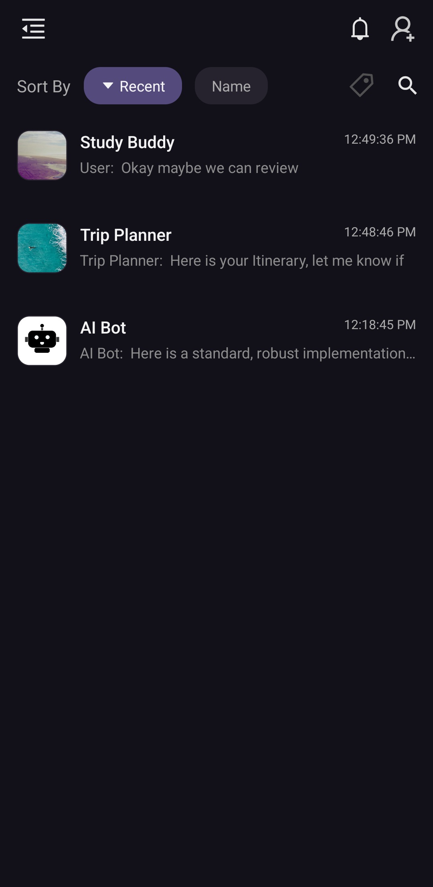
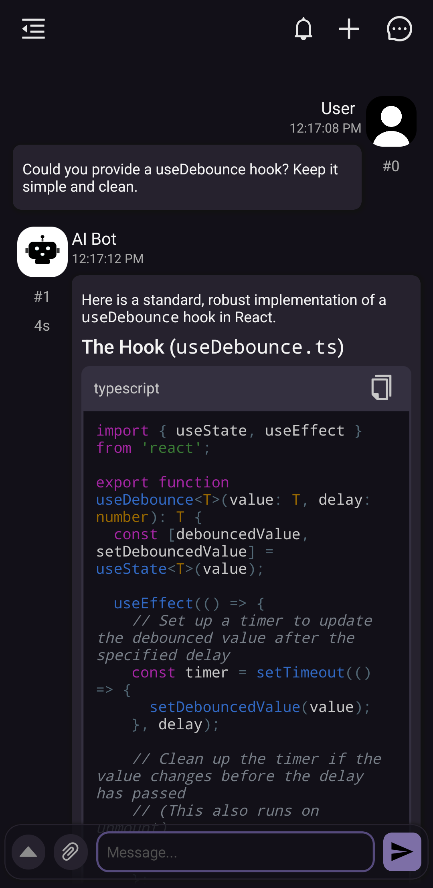
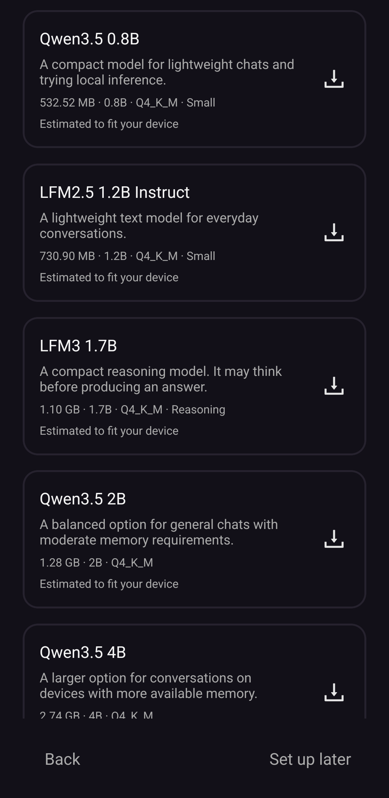
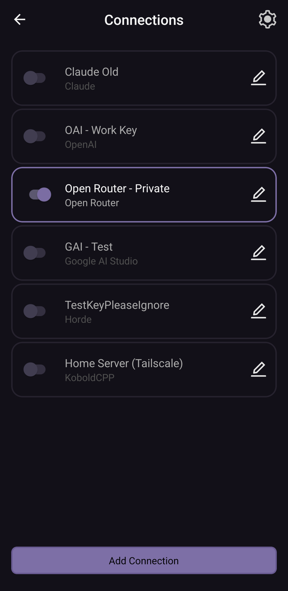
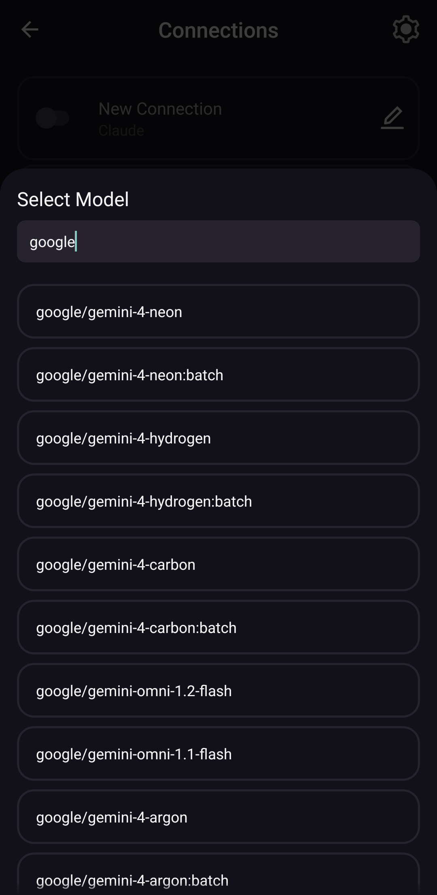
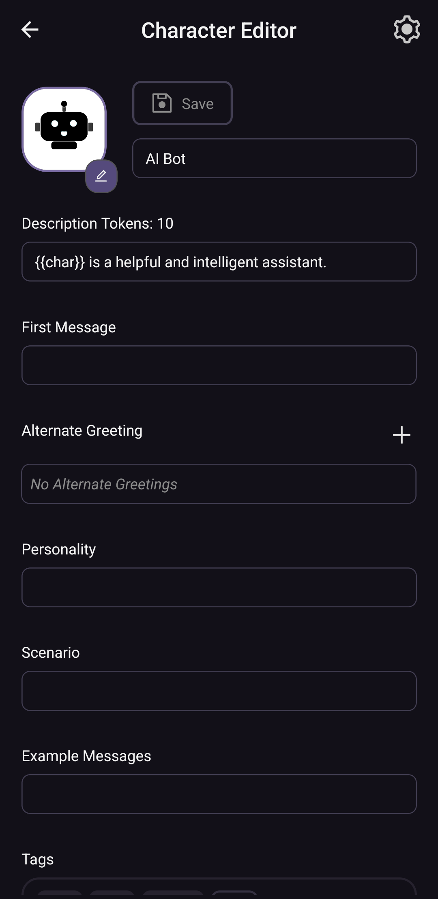
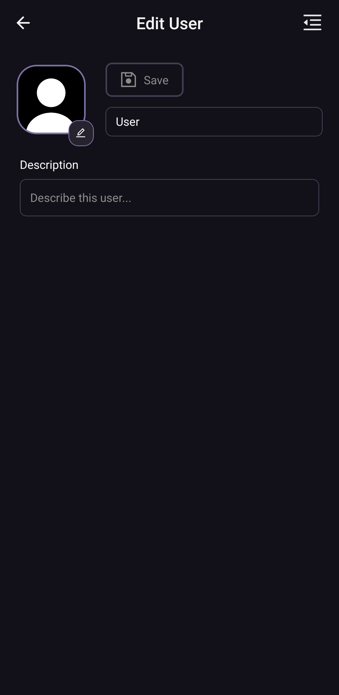
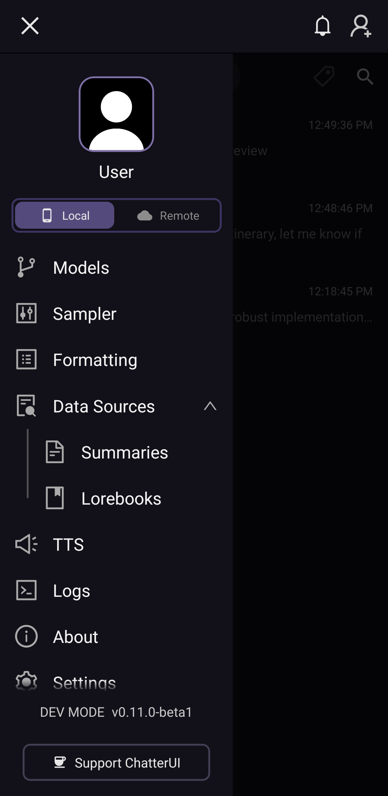

# ChatterUI - A simple app for LLMs

ChatterUI is a native mobile frontend for LLMs.

Run LLMs on device or connect to various commercial or open source APIs. ChatterUI aims to provide a mobile-friendly interface with fine-grained control over chat structuring.

If you like the app, feel free support me here:

Chat With Characters or Assistants
 

 
Use on-device Models or APIs
 

 
Modify And Customize
 

 

## Features:

- Run LLMs on-device in Local Mode
- Connect to various APIs in Remote Mode
- Chat with characters. (Supports the Character Card v2 specification.)
- Create and manage multiple chats per character.
- Customize Sampler fields and Instruct formatting
- Integrates with your device’s text-to-speech (TTS) engine

 

# Usage

Download and install latest APK from the [releases](https://github.com/Vali-98/ChatterUI/releases/latest) page.

<i>iOS is Currently unavailable due to lacking iOS hardware for development</i>

## Local Mode

ChatterUI uses a [llama.cpp](https://github.com/ggerganov/llama.cpp) under the hood to run gguf files on device. A custom adapter is used to integrate with react-native: [cui-llama.rn](https://github.com/Vali-98/cui-llama.rn)

To use on-device inferencing, first enable Local Mode, then go to Models > Import Model / Use External Model and choose a gguf model that can fit on your device's memory. The importing functions are as follows:

- Import Model: Copies the model file into ChatterUI, potentially speeding up startup time.
- Use External Model: Uses a model from your device storage directly, removing the need to copy large files into ChatterUI but with a slight delay in load times.

After that, you can load the model and begin chatting!

_Note: For devices with Snapdragon 8 Gen 1 and above or Exynos 2200+, it is recommended to use the Q4_0 quantization for optimized performance._

## Remote Mode

Remote Mode allows you to connect to a few common APIs from both commercial and open source projects.

### Open Source Backends:

- LMStudio
- koboldcpp
- Ollama

### Dedicated API:

- OpenAI
- Open Router
- Claude
- Cohere
- Mancer
- AI Horde

### Generic backends:

- Generic Text Completions
- Generic Chat Completions

_These should be compliant with any Text Completion/Chat Completion backends such as Groq or Infermatic._

### Custom APIs:

Is your API provider missing? ChatterUI allows you to define APIs using its template system.

Read more about it [here!](https://github.com/Vali-98/ChatterUI/discussions/126)

## Development

Refer to [CONTRIBUTING.md](https://github.com/Vali-98/ChatterUI/blob/master/docs/CONTRIBUTING.md)

## Acknowledgement

- [llama.cpp](https://github.com/ggerganov/llama.cpp) - the underlying engine to run LLMs
- [llama.rn](https://github.com/mybigday/llama.rn) - the original react-native llama.cpp adapter
